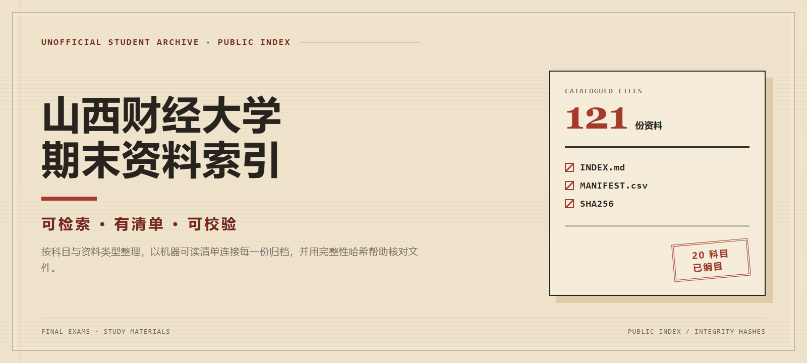

# 山西财经大学期末资料索引



> A searchable public index of final-exam and study materials for Shanxi University of Finance and Economics, organized with a manifest and integrity hashes.

本仓库将山西财经大学历年期末真题与复习资料按科目、资料类型整理，并提供可搜索的索引、机器可读清单与 SHA-256 校验值。当前收录 **121 份资料**，涵盖 **20 个科目**（另有 1 份未归类）。

本项目是学生自发整理的非官方资料库，与山西财经大学无隶属或合作关系，未获校方背书，也不代表校方立场。

## 快速查找

- 按资料类型与科目浏览：[INDEX.md](INDEX.md)
- 搜索完整文件清单：[MANIFEST.csv](MANIFEST.csv)
- 直接查看专题目录：[政治经济学历年真题](政治经济学-历年真题/README.md)（4 份）
- 在 GitHub 页面按 <kbd>t</kbd> 搜索文件名，或下载 `MANIFEST.csv` 后筛选科目、学年、资料类型与扩展名

## 资料统计

| 维度 | 数量 |
| --- | ---: |
| 文件总数 | 121 |
| 科目数 | 20（另有 1 份未归类） |
| 期末试卷 | 90 |
| 复习资料 | 22 |
| 其他资料 | 6 |
| 图片资料 | 3 |
| 政治经济学历年真题 | 4 |

文件格式包括 111 份 PDF、5 份 DOCX、2 份 DOC 与 3 份 JPG；统计以 [MANIFEST.csv](MANIFEST.csv) 为准。

## 仓库结构

```text
.
├── README.md                 # 项目入口与使用说明
├── INDEX.md                  # 按资料类型、科目整理的阅读索引
├── MANIFEST.csv              # 121 份文件的路径、属性与 SHA-256
├── 全部资料/                 # 按资料类型与科目归档的文件
├── 政治经济学-历年真题/      # 政治经济学试卷专题子集
└── docs/assets/              # README 与社交预览图的可复现源文件
```

## 如何使用 INDEX 与 MANIFEST

想快速浏览时，打开 [INDEX.md](INDEX.md)，先按「资料类型 + 科目」定位，再进入对应目录。政治经济学试卷也可通过[专题子集](政治经济学-历年真题/README.md)直接查看。

需要精确搜索、统计或校验时，使用 [MANIFEST.csv](MANIFEST.csv)。每行对应一份整理后的文件，包含来源期次、原始相对路径、整理后路径、专题路径、科目、资料类型、扩展名、字节数与 SHA-256。可在表格软件中筛选，也可在 PowerShell 中查询：

```powershell
Import-Csv .\MANIFEST.csv |
  Where-Object { $_.Subject -eq '高等数学' -and $_.MaterialType -eq '期末试卷' }
```

## 提交资料与纠错

提交新资料时，请提供：

- 科目
- 学年
- 资料类型（期末试卷、复习资料、图片资料或其他资料）
- 资料来源与允许公开的说明
- 已移除姓名、学号及其他可识别个人身份的信息

发现分类、文件信息或链接错误，或希望补充资料，请[新建 GitHub Issue](https://github.com/Xiaotian69/shanxi-caijing-exams/issues/new)，说明对应文件路径和建议修改内容。如需提供佐证，只填写处理所需的最少非敏感信息；不要在公开 Issue 中上传含个人信息的截图、身份材料或其他敏感证据。

## 隐私、版权与下架

> **权利说明**：本仓库收录的试卷与复习资料并非整理者原创，整理者**不拥有**这些文件的著作权，也**未取得**学校、命题教师或资料原作者的授权。「公开可访问」不等于「已获授权」。如你是权利人并希望删除，请按下方方式联系，维护者会优先处理。

本仓库仅用于学习交流与备考参考。对文件的整理、建立索引和计算哈希值，不代表底层文件的权利发生转移，也不构成对底层文件的重新许可。本仓库不授权任何商业性再分发。

如你是相关权利人，或发现资料包含姓名、学号等个人信息，可[新建 GitHub Issue](https://github.com/Xiaotian69/shanxi-caijing-exams/issues/new)提交下架或更正请求。请仅提供定位文件所需的最少非敏感信息，不要公开敏感证据或额外个人信息。

## 完整性说明

[MANIFEST.csv](MANIFEST.csv) 为每份整理后文件记录 `SizeBytes` 与 `SHA256`。SHA-256 可用于检查下载文件是否与清单记录一致，但不代表内容来源、正确性或权利状态已获得背书。

> 维护者说明：归档发生变化时，应先从 `MANIFEST.csv` 重新统计，再同步更新 `README.md`、`hero-source.html` 与 `social-preview-source.html` 中硬编码的汇总数字，并由两份 HTML 源重新生成 `hero.png` 和 `social-preview.png`；不要只更新其中一处。

PowerShell 校验示例：

```powershell
$row = Import-Csv .\MANIFEST.csv | Select-Object -First 1
(Get-FileHash -Algorithm SHA256 -LiteralPath $row.OrganizedRelativePath).Hash -eq $row.SHA256
```
